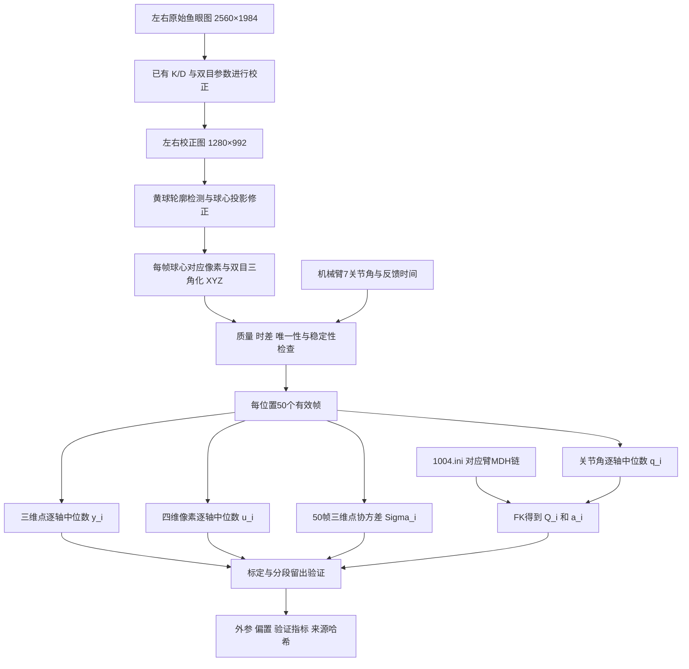
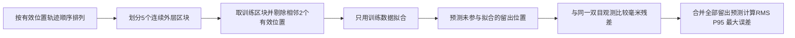
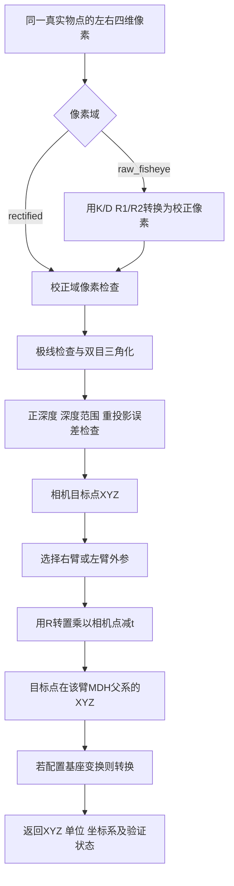

# 八种标定方法的机理与数据流

更新日期：2026-10-20。本文依据当前仓库代码和已保存的实验结果编写。

本文的“八种”指七种比较模型，加上最近执行的“固定左臂 pF Z=101 mm”约束方案。原有交替最小二乘也是一种求解实现，但与第一种联合刚体最小二乘采用同一个观测模型和目标函数，单独在第一种中说明，不重复计为一种物理模型。

当前 `vision_deploy v2.4.0` 使用普通刚体、自由 pF 的标定结果。左臂已恢复为约 `[0.195295, 0.725531, 99.374025]` mm；固定 Z=101 mm 的方案仅保留为实验结果。

## 1. 八种方案总览

| 序号 | 方案 | 代码入口/标识 | 优化变量 | 自由度 | 拟合残差 |
|---|---|---|---|---:|---|
| 1 | 刚体联合最小二乘 | `rigid_l2`；标准导出用 `solve_joint` | R、t、pF | 9 | 相机三维位置差 |
| 2 | Huber 鲁棒拟合 | `rigid_huber` | R、t、pF | 9 | 三维位置差，逐分量 Huber 损失 |
| 3 | 协方差加权刚体 | `rigid_covariance` | R、t、pF | 9 | 按每个位置的三维协方差白化 |
| 4 | 像素重投影优化 | `rigid_pixel` | R、t、pF | 9 | 左右四维校正像素差 |
| 5 | 刚体＋尺度 | `similarity` | R、t、pF、s | 10 | 加入统一尺度后的三维位置差 |
| 6 | 刚体＋逆深度偏差 | `depth_bias` | R、t、pF、b | 10 | 加入逆深度偏差后的三维位置差 |
| 7 | 仿射＋球心偏置 | `affine` | M、t、pF | 15 | 一般线性变换后的三维位置差 |
| 8 | 固定 pF Z 的约束刚体 | `solve_fixed_pf_z` / `--fixed-pf-z-mm` | R、t、pFx、pFy | 8 | 固定 pFz 后的三维位置差 |

R 用三维旋转向量参数化，因此只有3个自由度；M 是不受正交约束的3×3矩阵，有9个自由度。所有方案中的 pF 都表示从法兰原点到球心的向量。

这些方案估计的是相机相对机械臂参考系的配准关系和标记物偏置。相机内参、畸变参数、双目相对 R/T、MDH 长度与关节零位均作为已有输入，不在本轮优化中重新求解。第4种也不会重新标定相机内参。

## 2. 坐标系、符号与共同方程

| 符号 | 定义 | 单位/约定 |
|---|---|---|
| B | 当前所选机械臂的 MDH 父坐标系 | 与实际物理基座的关系尚未独立核验 |
| F | 当前所选机械臂的法兰局部坐标系 | 左右臂各自定义 |
| C | 校正后的左相机坐标系 | 与三角化使用的投影矩阵一致 |
| qᵢ | 第 i 个位置的7个关节角 | 输入为度 |
| Qᵢ、aᵢ | FK 得到的法兰旋转与原点位置 | `T_B_F(qᵢ)=[Qᵢ,aᵢ;0,1]`，位置单位m |
| pF | 法兰原点→球心，表达在F中 | m；展示时常乘1000转为mm |
| R、t | B→C 的相机外参 | `T_C_B=[R,t;0,1]`，t单位m |
| xᵢ | 由FK和pF预测的球心，表达在B中 | `xᵢ=aᵢ+Qᵢ pF` |
| yᵢ | 双目测得的球心，表达在C中 | m |
| uᵢ | 球心的校正域四维像素 | `[uL,vL,uR,vR]`，px |
| P_L、P_R | 校正双目投影矩阵 | 对应每眼1280×992 |

本文公式按列向量写，代码部分使用行向量批处理，转置后的含义相同。

共同刚体观测方程：

$$
x_i=a_i+Q_i p_F,\qquad \hat y_i=R x_i+t,\qquad r_i=\hat y_i-y_i.
$$

相机外参方向是“机械臂MDH父系→相机”。部署时需要反向计算：

$$
P_B=R^T(P_C-t).
$$

MDH 由原始 `configs/1004.ini` 提供：左臂 R.A0、右臂 R.A1，各7关节并乘固定 FLANGE 段。机器人型号 M6S-CCS-696，模型说明见[机械臂几何文档](../vision_deploy/stereo_robot/docs/robot_model.md)。

## 3. 共用采集与预处理数据流



当前数据规模：

| 数据集 | 全部位置 | 有效位置 | 拒绝位置 | 有效帧 |
|---|---:|---:|---:|---:|
| 右臂第二批 | 360 | 288 | 72 | 14400 |
| 左臂 | 482 | 424 | 58 | 21200 |

读取归档时检查相机/MDH哈希、左右臂身份、源帧唯一性和融合结果，并用对应臂的MDH重算FK。拒绝记录保留在归档中，但不参加拟合；没有根据拟合残差再删除位置。

每个位置先逐帧三角化，再对50个三维点取逐轴中位数。它通常不等于“先对像素取中位数，再三角化”。第4种使用单独融合的四维像素 uᵢ，因此其二维拟合目标与其余方案的融合三维目标也存在统计口径差异。

黄球上游按40 mm直径假设做球心投影修正。归档中部分名为 `raw_stereo_pixels` 的字段实际是校正图上的未做球心修正的轮廓中心，不是原始鱼眼像素。运行时复算应使用 `corrected_stereo_pixels`，不可仅凭字段中的 `raw` 选择 `raw_fisheye` 域。

数据来源：[右臂归档](../datasets/drag_replay_20261020_091535_901340/README.md)、[左臂归档](../datasets/left_drag_replay_20261020_110645_673779/README.md)。

## 4. 八种方法的标定机理

### 4.1 刚体联合最小二乘

目标函数：

$$
\min_{R,t,p_F}\sum_i\|R(a_i+Q_i p_F)+t-y_i\|_2^2,\qquad R\in SO(3).
$$

联合非线性实现使用旋转向量参数化R，把9个变量交给 `scipy.optimize.least_squares`，使用线性损失。初值 pF=[0,0,0.1]m，先由该偏置对应的FK球心和观测点做SVD刚体配准，初始化R/t。

标准 `solve_joint` 实现交替求解同一目标：固定pF，以SVD精确求R/t；固定R/t，把pF作为线性最小二乘变量更新。它尝试3个pF初值，用收敛后残差中位数选择候选。项目已数值核对交替解与联合非线性解的一致性。

数据流：

```text
q + MDH → Q,a → a+Q·pF → R(·)+t → 与双目y做3D差
                                      ↓
                          联合更新R、t、pF，直到收敛
```

适合保留明确的刚体几何语义。大残差被平方放大，因此异常点可能影响结果。姿态变化不足时pF与平移可能耦合，增加同姿态位置数量不能完全代替姿态多样性。当前部署采用该方案。

### 4.2 Huber 鲁棒拟合

预测方程和9个变量与4.1相同，改变的是损失函数。代码将三维残差展平，对每个标量分量分别应用Huber：

$$
\min\sum_{i,k}\ell_\delta(r_{ik}),\qquad
\ell_\delta(e)=\begin{cases}\tfrac12e^2,&|e|\le\delta\\\delta(|e|-\tfrac12\delta),&|e|>\delta\end{cases},
\quad\delta=0.0007\text{ m}.
$$

数据流：`FK球心 → 刚体预测 → 逐轴残差 → Huber损失 → 更新R/t/pF`。

小残差区域与普通最小二乘相同，大残差区域影响增长较慢。该实现不是以整点三维距离计算一个统一Huber权重，也没有把大残差点删除。它适合缓和少量异常观测的影响，不能消除相机或FK的系统偏差。当前左臂RMS改善约0.006 mm，不足以据此证明稳定精度提升。

### 4.3 协方差加权刚体

每个位置由50帧三维点云估计样本协方差Σᵢ。加入固定0.2 mm噪声下限：

$$
\widetilde\Sigma_i=\Sigma_i+(0.0002)^2I,\quad
W_i=\widetilde\Sigma_i^{-1/2},\quad
\min\sum_i\|W_i r_i\|_2^2.
$$

代码用对称特征分解计算Wᵢ。抖动大的方向权重较低，稳定的方向权重较高；噪声下限避免几乎静止的窗口获得无限大权重。

数据流：

```text
50帧相机XYZ → 样本协方差 → 加0.2mm噪声下限 → 白化矩阵W
FK球心 → 刚体预测 → 与融合y的残差 → W·残差 → 更新R/t/pF
```

此处使用帧点云协方差，没有除以50，也不是融合中位数的严格协方差，更不是最终外参/pF的置信区间。稳定但存在固定偏差的观测依然可能获较高权重，因此加权不能代替独立准确度验证。

### 4.4 像素重投影优化

先通过FK、pF和外参预测相机中的球心，再用固定P_L/P_R投影回左右图像：

$$
\hat u_i=\begin{bmatrix}\pi(P_L[\hat y_i;1])\\\pi(P_R[\hat y_i;1])\end{bmatrix},\qquad
\min_{R,t,p_F}\sum_i\|\hat u_i-u_i\|_2^2.
$$

π表示齐次坐标除以第三分量。残差单位为px，每个位置4个标量。拟合结束后，为与其他方法公平比较，仍以预测相机三维球心与同一yᵢ之间的距离计算毫米误差。

数据流：`FK球心 → 相机预测XYZ → 左右P投影 → 与观测四维像素比较 → 更新R/t/pF`。

该方法直接拟合像素观测，隐含各像素分量同权；它不保证三维RMS更小，尤其深度对视差敏感。P_L/P_R、K/D保持固定，没有优化球径或重新处理球轮廓。

### 4.5 刚体＋尺度（相似变换）

在旋转前对整个机械臂参考系球心坐标施加统一尺度：

$$
\hat y_i=R\{s(a_i+Q_i p_F)\}+t,\qquad s=\exp(\lambda),\quad0.95\le s\le1.05.
$$

优化R/t/pF及λ共10个变量，以三维残差平方和为目标。尺度同时作用于法兰位置aᵢ和偏置QᵢpF，t不乘s。

数据流：`FK球心 → 乘尺度s → R旋转+t → 与双目y比较 → 更新10个变量`。

反算普通点的数学公式：

$$
P_B=\frac1sR^T(P_C-t).
$$

该模型可以吸收整体尺度差异，但不能据此断言真实机械臂尺寸或相机基线应按s修改。导出的矩阵线性部分为sR，除s=1外并非纯旋转；当前部署导出器拒绝该实验模型。

### 4.6 刚体＋逆深度偏差

先构造刚体预测cᵢ，再施加沿相机射线的深度映射：

$$
c_i=R(a_i+Q_i p_F)+t,\qquad\hat y_i=\frac{c_i}{1+b\,c_{iz}},\qquad-0.2\le b\le0.2\ \mathrm{m}^{-1}.
$$

因此 `1/ŷz = 1/cz + b`。它不是简单给Z加常数，X/Y/Z都会按同一分母缩放。优化9个刚体/偏置变量加b，以三维残差平方和拟合。

数据流：`FK球心 → 刚体相机坐标c → 逆深度映射 → 与双目y比较 → 更新R/t/pF/b`。

若要反算实验模型，需要先撤销映射：

$$
c=\frac{y}{1-b y_z},\qquad P_B=R^T(c-t).
$$

正反变换分母需远离0，并保持有效正深度。R本身仍是旋转，但仅导出R/t会遗漏b，不能复现该方案。当前 `vision_deploy` 不执行这一补偿，也拒绝直接导出此模型。b是解释系统误差的经验参数，尚未被独立证明对应某个真实硬件误差。

### 4.7 仿射＋球心偏置

把旋转R换成一般3×3矩阵M：

$$
\hat y_i=M(a_i+Q_i p_F)+t,\qquad
\min_{M,t,p_F}\sum_i\|\hat y_i-y_i\|_2^2.
$$

共15个变量。虽然固定pF后对M/t是线性的，但M与pF共同出现时包含乘积，当前代码用联合非线性最小二乘求解。

数据流：`FK球心 → 一般线性矩阵M+t → 与双目y比较 → 更新M/t/pF`。

M可表示旋转、各向异性尺度和剪切。只在M可逆且条件适宜时才能反算：`P_B=M⁻¹(P_C−t)`。奇异值偏离1说明它偏离刚体旋转；低残差可能来自吸收多种系统误差，不能视为真实相机姿态更准确。当前部署拒绝仿射模型。

### 4.8 固定 pF Z 的约束刚体

最近实验给定左法兰局部 `pFz=0.101 m`：

$$
p_F=[p_x,p_y,0.101]^T,\qquad
\min_{R,t,p_x,p_y}\sum_i\|R(a_i+Q_i p_F)+t-y_i\|_2^2.
$$

共8个自由变量。实现先用自由pF交替解初始化，再把Z从优化变量中移除，只更新R/t/X/Y；全量拟合及每个留出折都施加同一硬约束。收敛后检查偏置长度及8列Jacobian的秩。

数据流：`指定pFz → 与待估pFx/pFy组成pF → FK球心 → 刚体预测 → 三维差 → 更新8个变量`。

这不是拟合完成后把JSON中的Z直接改为101。改变Z会带动X/Y与R/t变化，也会改变基于左臂外参计算的双臂对齐关系。该方案保持了刚体几何，因此其结果可以部署，但用户已选择恢复自由pF方案。

## 5. 项目已有结果与当前选择

以下均为连续轨迹分段留出误差，单位mm。前七行取各臂多方法比较结果；第八行取单独约束实验，未纳入七模型嵌套选型。

| 方案 | 右臂RMS | 右臂P95 | 左臂RMS | 左臂P95 |
|---|---:|---:|---:|---:|
| 刚体联合最小二乘 | 0.912 | 1.678 | 0.866 | 1.520 |
| Huber鲁棒拟合 | 0.912 | 1.673 | 0.860 | 1.508 |
| 协方差加权 | 0.908 | 1.696 | 0.864 | 1.513 |
| 像素重投影 | 0.895 | 1.694 | 0.973 | 1.741 |
| 刚体＋尺度 | 0.898 | 1.703 | 0.874 | 1.584 |
| 刚体＋逆深度偏差 | 0.897 | 1.704 | 0.881 | 1.629 |
| 仿射＋球心偏置 | 0.858 | 1.650 | 0.839 | 1.621 |
| 固定左臂pF Z=101mm | 未执行 | 未执行 | 1.018 | 1.755 |

右臂和左臂的数据覆盖不同，不能用这两列直接评价哪条机械臂硬件更准确。所有分数都未证明P95≤1mm；不同方法几微米级的分数差异也未经过独立实验验证。

当前参数：

| 项目 | 当前采用值 |
|---|---|
| 右臂pF，mm | `[1.0818591758443583, -0.32812947027856005, 101.34772931324594]` |
| 左臂pF，mm | `[0.19529451759160675, 0.7255311630955164, 99.37402499765628]` |
| 右臂外参来源 | `reports/pro_recalibration_20261020_360/rigid_candidate.json` |
| 左臂外参来源 | `configs/orin_pro_left_ball_registration_20261020_424.json` |
| 当前部署 | `vision_deploy v2.4.0`，普通刚体，自由pF |

固定Z实验得到左臂pF约 `[-0.420197, 0.855844, 101.000000]`mm，留出RMS/P95上升。其报告保留于[固定Z实验报告](../reports/pro_left_pf_z101_20261020/report.md)，不作为当前部署参数。

## 6. 验证数据流与误差的含义



同一位置的50帧不拆到训练与验证两边。七模型比较另在每个外层训练集内进行4折内层选型，避免直接用外层测试结果选择该折模型。嵌套选型分数评价的是“选型流程”，不是某个全量最终模型的独立绝对精度。固定Z方案沿用5折留出，但不参与该七模型的内层选择。

拟合误差使用参加拟合的数据；留出误差使用未参与该折拟合的位置。RMS是三维距离平方均值的平方根；P95是这些距离的95分位。另保存单轴偏差、单轴RMS、最大误差和≤1mm比例。

若用视觉球心推算法兰原点：

$$
P_{B,\mathrm{flange}}^{vis}=R^T(y_i-t)-Q_i p_F.
$$

与FK原点aᵢ比较，其三维误差范数等于刚体标定的球心残差范数，因为刚体旋转保持距离。因此“视觉法兰/FK一致”与“球心预测残差小”在该验证链中不是两份独立证据。它们共同依赖MDH、关节角、视觉球心、外参和pF。

pF与R/t联合估计，错误的pF约束可能由R/t部分吸收。部署时不用pF，不代表标定阶段的pF偏差无法影响普通目标精度。

## 7. 双臂统一参考系的数据流

右臂既有外参作为固定锚。先分别求出两条臂的原生相机外参，再计算：

$$
T_{B_R\leftarrow B_L}=T_{C\leftarrow B_R}^{-1}T_{C\leftarrow B_L}.
$$

```text
右臂FK + 右臂球心观测 → 右外参T_C_BR（当前固定锚）
左臂FK + 左臂球心观测 → 左外参T_C_BL
                    ↓
          inverse(T_C_BR) × T_C_BL
                    ↓
            左MDH父系 → 右MDH父系
```

没有独立测量的左右安装变换；该对齐是通过共同相机推得。左臂重新标定不会独立校正固定的右臂相机外参。左臂pF始终表达在左法兰系，不能直接把它当作右MDH父系中的位移。

## 8. 在线任意目标的数据流



运行输入是任意目标的同一真实物点，不要求固定在法兰上。运行时不执行FK、不读取关节角、不加减pF。输出是所输入物点的位置；只有输入确实代表法兰原点的投影时，才能直接解释成法兰原点位置。

`arm='right'`始终选择右臂参考系，与目标由哪条臂夹持无关；要求所有物体统一右臂表达时始终选right。`arm='left'`选择左臂参考系。当前默认名称分别为 `right_arm_mdh_parent` 和 `left_arm_mdh_parent`；实际物理基座尚未独立核验，严格要求实际基座时应配置并验证基座变换。

运行检查包括≤0.5px极线纵差、正深度、0.15–5m深度和≤0.5px重投影误差。运行允许的深度范围不等于已验证的精度范围：右臂采集深度约0.286–0.616m，左臂约0.239–0.562m。

黄球标定使用球心修正及静态50帧融合；任意物体单帧检测未必具有相同定位质量。检测框中心也未必是同一真实物点。当前约0.9mm的留出RMS不能直接承诺为任意目标的实时绝对精度。

## 9. 代码、文件与复现入口

| 内容 | 文件与函数 |
|---|---|
| 帧质量、融合及FK | [pro_capture.py](../interactive_ball_calibration/pro_capture.py)：`validate_camera`、`fuse`、`flange_pose` |
| 交替刚体/pF求解 | [registration.py](../interactive_ball_calibration/registration.py)：`rigid_fit`、`solve_joint` |
| 七模型预测、拟合、反算及嵌套验证 | [compare_pro_calibration.py](../interactive_ball_calibration/compare_pro_calibration.py)：`model_predict`、`fit_model`、`camera_to_arm`、`compare` |
| 标准/固定Z标定 | [pro_fit.py](../interactive_ball_calibration/pro_fit.py)：`load_capture`、`fit`、`solve_fixed_pf_z` |
| 双臂对齐 | [align_arm_frames.py](../interactive_ball_calibration/align_arm_frames.py)：`align_models` |
| 导出部署参数 | [export_calibration.py](../vision_deploy/export_calibration.py)：`export_bundle` |
| 在线通用点推理 | [geometry.py](../vision_deploy/stereo_robot/geometry.py)：`rectify_pixels`、`predict` |
| 右臂比较结果 | [comparison.json](../reports/pro_recalibration_20261020_360/comparison.json) |
| 左臂比较结果 | [comparison.json](../reports/pro_left_registration_20261020_482/comparison.json) |
| 当前使用说明 | [vision_deploy/README.md](../vision_deploy/README.md) |

以下在仓库根目录运行，需要分析依赖；输出路径必须不存在：

```bash
# 七种模型的左臂比较，包含嵌套分段验证
python -m interactive_ball_calibration.compare_pro_calibration \
  --arm left \
  --dataset datasets/left_drag_replay_20261020_110645_673779 \
  --output /tmp/left_seven_methods

# 原自由pF刚体方案
python -m interactive_ball_calibration.pro_fit \
  --arm left \
  --capture datasets/left_drag_replay_20261020_110645_673779/replay_capture.jsonl.gz \
  --output /tmp/left_free_pf.json

# 固定左臂pF Z=101mm的实验
python -m interactive_ball_calibration.pro_fit \
  --arm left --fixed-pf-z-mm 101 \
  --capture datasets/left_drag_replay_20261020_110645_673779/replay_capture.jsonl.gz \
  --output /tmp/left_fixed_z101.json

# 默认导出当前采用的原无约束左臂方案和固定右臂锚
python vision_deploy/export_calibration.py --output /tmp/current_vision_bundle
```

本次仅整理方法与数据流，未重新执行标定或实机测试。表格引用已有结果；独立物理基座、pF实测误差和任意物体绝对精度仍需另行验证。
